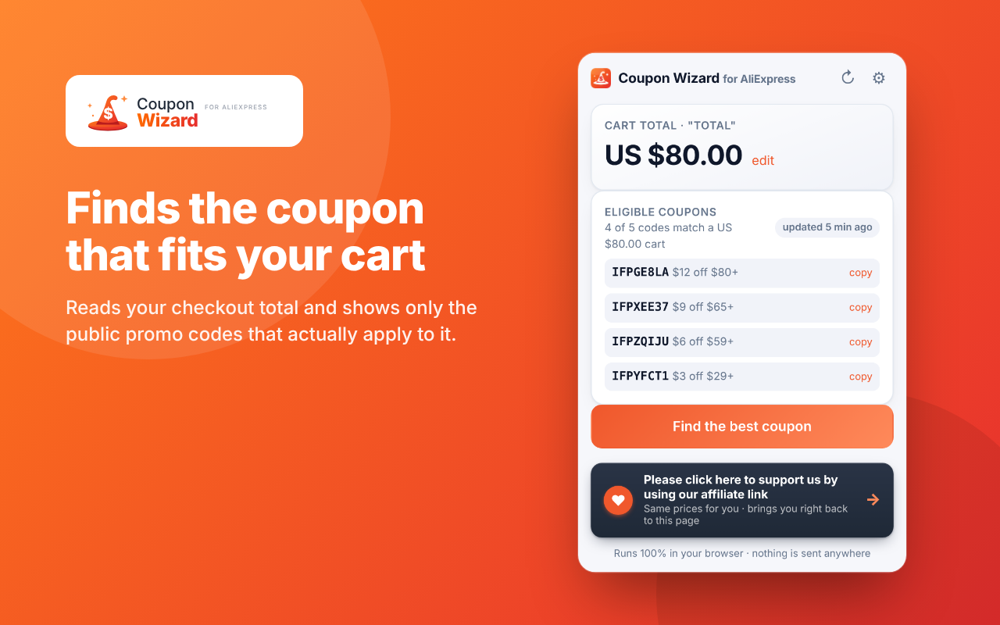
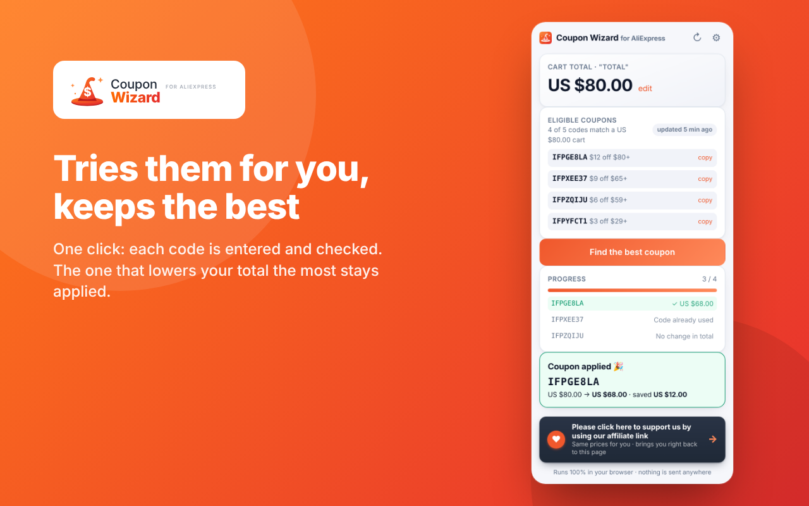
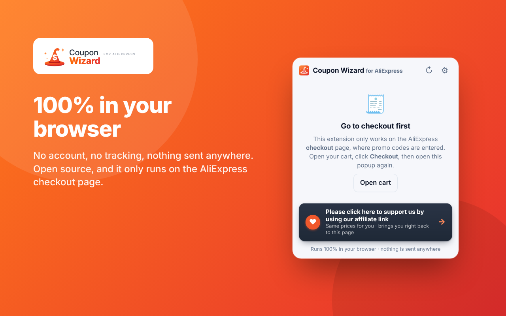

# Coupon Wizard for AliExpress

A Chrome extension that finds public AliExpress promo codes matching your checkout total
and tries them for you until the lowest price wins. Runs 100% in your browser — no account,
no tracking, nothing sent anywhere.

- **Website:** https://sysmesh.github.io/coupon-wizard-for-aliexpress/
- **Privacy policy:** [PRIVACY.md](PRIVACY.md) · https://sysmesh.github.io/coupon-wizard-for-aliexpress/privacy.html
- **Download:** [Releases](https://github.com/sysmesh/coupon-wizard-for-aliexpress/releases) (the same zip that is uploaded to the Chrome Web Store)
- **Problems / questions:** [Issues](https://github.com/sysmesh/coupon-wizard-for-aliexpress/issues)

## How it works

1. Add items to your AliExpress cart and go to **Checkout**.
2. Click the Coupon Wizard icon — it shows your cart total and the public codes that match it.
3. Click **Find the best coupon**. Each code is entered and checked; the best one stays applied.

  

## Install without the Web Store

Download the zip from the [latest release](https://github.com/sysmesh/coupon-wizard-for-aliexpress/releases),
unzip it, open `chrome://extensions`, enable **Developer mode**, click **Load unpacked**, pick the folder.

## Support the developer (optional)

The popup has a clearly labelled **"Support us"** button. If — and only if — you click it, your tab goes
through the developer's AliExpress affiliate link and straight back to your cart. Same prices for you.

---

An independent project by **Gilad Ariav**. Not affiliated with, endorsed by, or connected to AliExpress or
Alibaba Group; "AliExpress" is a trademark of its owner. Released under the [MIT License](LICENSE).

## Releases

Each version's upload zip is kept in [`releases/`](releases/) and attached to the matching
[GitHub release](https://github.com/sysmesh/coupon-wizard-for-aliexpress/releases).
